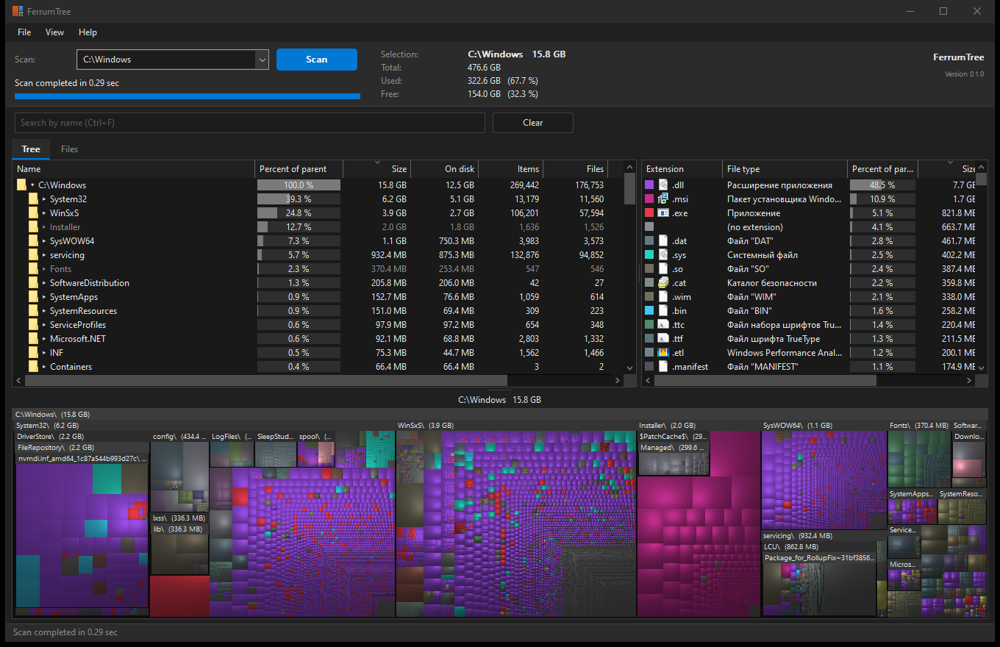

# FerrumTree

Disk space analyzer for Windows. It reads the NTFS Master File Table directly, shows
folders and files by size in a tree, a list of file types and a treemap, and keeps all
of it current from the NTFS change journal.

[Русская версия](README.ru.md)



## Features

- Full scan of an NTFS volume straight from the MFT, in parallel. Repeat scans load a
  cache and apply only the changes recorded in the USN journal since the last run, which
  takes a fraction of a second.
- Live updates. Files created, renamed, resized or deleted on the volume appear in the
  tree within a few tens of milliseconds, without rescanning. Deleted items stay in the
  list struck through until the next scan.
- Tree with size, size on disk, percentage of the parent, item, file and folder counts,
  last change time. Sorting by any column.
- File types with totals and Explorer icons; selecting a type highlights it on the
  treemap.
- Squarified treemap with cushion shading, folder headers and zoom.
- Search by name with wildcards (`*.mp4`, `report*`, `a?c`) over all files of a volume.
- Duplicate files finder (size, then a hash of the first 64 KB, then a full hash).
- Explorer context menu on files and folders, deletion to the Recycle Bin or permanently,
  copy and cut to the clipboard, export to CSV, treemap export to PNG.
- FAT32, exFAT, ReFS, network shares and single folders are read with a parallel
  directory walk.
- Light and dark theme following Windows, English and Russian interface.
- Portable: a single executable, nothing installed, nothing written outside its folder.

## Requirements

- Windows 10 or 11, x64.
- Administrator rights for reading NTFS volumes directly (the program asks for them on
  start). Without them only the directory walk is available.

## Usage

Download the archive from the Releases page, unpack it anywhere and run
`ferrumtree-gui.exe`. `ferrumtree.exe` is the command line version (run it without
arguments for help).

Keyboard: F5 scan, Shift+F5 full scan without cache, F3 select folder, F4 collapse all,
F6 select parent, F8 file types, F9 treemap, F10 and F11 zoom the treemap, Ctrl+F search,
Ctrl+E show in Explorer, Del delete to the Recycle Bin, Shift+Del delete permanently.

### Files the program writes

Only next to its own executable:

| File | Contents |
| --- | --- |
| `FerrumTree.ini` | Settings |
| `FerrumTree-<volume serial>.ftc` | Cache of a volume's file records, one file per volume |

The cache can be turned off or deleted in the View menu. Scanned volumes are opened
read-only.

### Live updates

View, Track changes on disk:

- Never: the tree is a snapshot; F5 refreshes it (instantly when the cache is on).
- While the window is active (default): nothing runs while another window is in front;
  changes made meanwhile are applied when the window is activated again.
- Always.

## Performance

Measured on the author's machine: system volume with 1.3 million files and folders, MFT
of 1.9 GB on a SATA SSD reading about 200 MB/s.

| | |
| --- | --- |
| Full scan | about 9.4 s, limited by the disk |
| Repeat scan with cache | about 0.2 s |
| Memory after a scan | about 110 MB |
| Search over 1.3 million names | under 10 ms |
| Applying a change on disk to the tree | under 0.1 ms |

## Building from source

1. Install [Build Tools for Visual Studio](https://visualstudio.microsoft.com/visual-cpp-build-tools/)
   with the "Desktop development with C++" workload (the linker and the Windows SDK).
2. Install Rust from [rustup.rs](https://rustup.rs) with the default settings.
3. Download the source (Code, Download ZIP) or clone it:
   `git clone https://github.com/dyrb/ferrumtree`
4. In the source folder run:

   ```
   cargo build --release
   ```

   The first build downloads two dependencies and takes a minute or two. The programs
   are then in `target\release`: `ferrumtree-gui.exe` and `ferrumtree.exe`.

`scripts\build-release.ps1` builds the release archive with a SHA-256 checksum in `dist`.

Tests: `cargo test --workspace`. The tests run on synthetic data and need neither
administrator rights nor a particular volume. `ferrumtree.exe check-usn C:` compares the
journal-updated cache with a fresh full scan of a real volume.

## How it works

| Crate | Purpose |
| --- | --- |
| `ft-ntfs` | Read-only volume access, MFT layout from `$MFT:$DATA` and `$MFT:$BITMAP`, parallel record parser |
| `ft-index` | Compact tree in breadth-first order: totals in one pass, no per-node allocations; in-place updates |
| `ft-usn` | Record cache kept as a memory-mapped file, USN journal reader |
| `ft-search` | Name search |
| `ft-treemap` | Treemap layout and rendering |
| `ft-fallback` | Directory walker for volumes without an MFT |
| `ft-dupes` | Duplicate finder |
| `ferrumtree-gui` | Win32 interface (`windows-sys` only) |
| `ferrumtree` | Command line |

Live updates wait inside NTFS (`FSCTL_READ_USN_JOURNAL`) until the journal grows, re-read
only the changed MFT records and send the user interface each record before and after
the change. The tree is patched in place: the node and the totals along its parent chain.
A full rebuild is used only for changes to hard links or more than 100,000 records at
once.

## Known limitations

- NTFS updates the last change time of folders lazily, so it can lag behind; sizes are
  exact.
- Files that a system process keeps open for a long time (for example registry hives)
  may show outdated sizes until they are closed or the volume is rescanned.
- Tested on Windows 10 x64 only so far.

## License

Licensed under either of [Apache License, Version 2.0](LICENSE-APACHE) or
[MIT license](LICENSE-MIT) at your option.
