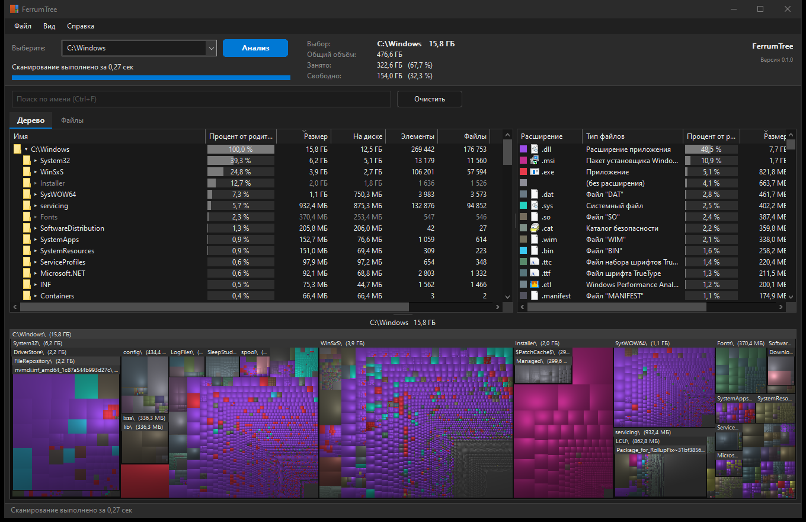

# FerrumTree

[](https://github.com/dyrb/ferrumtree/actions/workflows/ci.yml)
[](https://github.com/dyrb/ferrumtree/releases/latest)
[](#лицензия)


Анализатор занятого места на дисках для Windows. Читает главную файловую таблицу NTFS
(MFT) напрямую, показывает папки и файлы по размеру в виде дерева, список типов файлов и
графическую карту и поддерживает всё это в актуальном состоянии по журналу изменений NTFS.

[English version](README.md)



## Возможности

- Полное сканирование тома NTFS прямо из MFT, параллельно. Повторное сканирование
  загружает кеш и применяет только изменения из журнала USN с прошлого запуска, это
  занимает доли секунды.
- Обновление на ходу. Созданные, переименованные, изменённые и удалённые на диске файлы
  появляются в дереве через несколько десятков миллисекунд, без повторного сканирования.
  Удалённое остаётся в списке зачёркнутым до следующего сканирования.
- Дерево с размером, размером на диске, процентом от родителя, числом элементов, файлов и
  папок, временем изменения. Сортировка по любой колонке.
- Типы файлов с итогами и значками Проводника; выбор типа подсвечивает его на карте.
- Графическая карта (squarified treemap) с объёмной заливкой, заголовками папок и
  масштабированием.
- Поиск по имени с подстановочными знаками (`*.mp4`, `report*`, `a?c`) по всем файлам тома.
- Поиск дубликатов (размер, затем хеш первых 64 КБ, затем полный хеш).
- Контекстное меню Проводника, удаление в Корзину или окончательно, копирование и
  вырезание в буфер обмена, экспорт в CSV, сохранение карты в PNG.
- FAT32, exFAT, ReFS, сетевые папки и отдельные папки читаются параллельным обходом.
- Светлая и тёмная тема по настройке Windows, русский и английский интерфейс.
- Портативность: один исполняемый файл, ничего не устанавливается, ничего не пишется за
  пределы своей папки.

## Требования

- Windows 10 или 11, x64.
- Права администратора для прямого чтения томов NTFS (программа запрашивает их при
  запуске). Без них доступен только обход папок.

## Использование

Скачайте архив со страницы Releases, распакуйте в любую папку и запустите
`ferrumtree-gui.exe`. `ferrumtree.exe` это версия для командной строки (без аргументов
выводит справку).

Клавиши: F5 анализ, Shift+F5 полное сканирование без кеша, F3 выбор папки, F4 свернуть все
ветви, F6 родительский элемент, F8 типы файлов, F9 карта, F10 и F11 масштаб карты,
Ctrl+F поиск, Ctrl+E показать в Проводнике, Del удалить в Корзину, Shift+Del удалить
окончательно.

### Что программа записывает

Только рядом со своим исполняемым файлом:

| Файл | Содержимое |
| --- | --- |
| `FerrumTree.ini` | Настройки |
| `FerrumTree-<серийный номер тома>.ftc` | Кеш записей тома, по файлу на том |

Кеш можно отключить или удалить в меню «Вид». Сканируемые тома открываются только для
чтения.

### Отслеживание изменений

Вид, Отслеживать изменения на диске:

- Никогда: дерево остаётся снимком, F5 обновляет его (с кешем мгновенно).
- Когда окно активно (по умолчанию): пока на переднем плане другое окно, программа ничего
  не делает; изменения за это время применяются при возврате к окну.
- Всегда.

## Производительность

Полное сканирование системного тома без кеша:

| | ПК 1 | ПК 2 |
| --- | --- | --- |
| Процессор | AMD Ryzen 7 5700X | Intel Core i5-10400F |
| Диск | Kingston KC3000 1 ТБ, NVMe | DEXP C100 512 ГБ, SATA |
| Файлов и папок | 755 579 | 1 294 744 |
| **Полное сканирование** | **0,36 с** | **9,4 с** |

Время полного сканирования определяется скоростью диска. Повторное сканирование с кешем
занимает около 0,2 с, памяти после сканирования используется около 110 МБ.

## Сборка из исходного кода

1. Установите [Build Tools for Visual Studio](https://visualstudio.microsoft.com/visual-cpp-build-tools/)
   с набором «Разработка классических приложений на C++» (компоновщик и Windows SDK).
2. Установите Rust с [rustup.rs](https://rustup.rs) с настройками по умолчанию.
3. Скачайте исходный код (Code, Download ZIP) или клонируйте его:
   `git clone https://github.com/dyrb/ferrumtree`
4. В папке с исходным кодом выполните:

   ```
   cargo build --release
   ```

   Первая сборка скачивает две зависимости и занимает минуту-две. Программы появятся в
   `target\release`: `ferrumtree-gui.exe` и `ferrumtree.exe`.

`scripts\build-release.ps1` собирает архив релиза с контрольной суммой SHA-256 в `dist`.

Тесты: `cargo test --workspace`. Тесты работают на синтетических данных и не требуют ни
прав администратора, ни определённого тома. `ferrumtree.exe check-usn C:` сравнивает
обновлённый по журналу кеш с новым полным сканированием реального тома.

## Ограничения

- Время изменения папок NTFS обновляет с задержкой, поэтому оно может отставать; размеры
  точные.
- Файлы, которые системный процесс долго держит открытыми (например, кусты реестра),
  могут показывать устаревший размер до закрытия или нового сканирования.
- Пока проверено только на Windows 10 x64.

## Лицензия

На выбор: [Apache License 2.0](LICENSE-APACHE) или [MIT](LICENSE-MIT).
